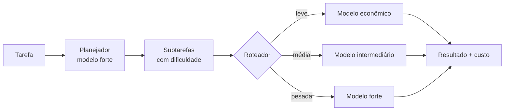

# Agent Orchestrator .NET

Orquestrador de múltiplos agentes de IA em **.NET 10** com painel em **Blazor**.
Um agente **planejador** divide a tarefa em subtarefas e classifica a dificuldade de cada uma. Um **roteador** manda cada subtarefa para o modelo mais barato que dá conta dela, e os **executores** rodam em paralelo. No fim, o painel mostra tokens, custo e quanto foi economizado em relação a usar sempre o modelo mais caro.

[](https://github.com/iuri-ferreira27/agent-orchestrator-dotnet/actions/workflows/ci.yml)

## O problema

Usar sempre o modelo de IA mais forte funciona, mas sai caro. Boa parte do trabalho (renomear variáveis, resumir, formatar) não precisa de um modelo de ponta.

## A solução



| Técnica | Como reduz custo |
|---|---|
| **Roteamento por dificuldade** | Subtarefas simples vão para modelos mais baratos |
| **Execução paralela** | As subtarefas rodam ao mesmo tempo (`SemaphoreSlim` + `Task.WhenAll`), reduzindo o tempo total |
| **Prompt caching** | As instruções fixas (system prompt) são marcadas para cache e, nas chamadas seguintes, cobradas a uma fração do preço |
| **Limite de saída** | `MaxOutputTokens` configurável por papel (planejador e executor) |

### Como a economia é medida

`CompareAsync` gera **um único plano** e o executa duas vezes: uma com tudo no modelo forte (linha de base) e outra com roteamento. Assim, a diferença de custo vem só da escolha dos modelos. O modo roteado roda **primeiro**, de propósito: se o cache aquecido por uma execução favorecer a outra, a vantagem fica com a linha de base, e a economia nunca sai inflada.

Exemplo de execução **simulada** com os preços de exemplo do `appsettings.json` e a tarefa de revisão de script Lua que vem preenchida no painel: 5 subtarefas (2 pesadas, 3 leves) e **35,6% de economia**.

> **Importante:** no modo simulado, os tokens são estimados e os preços são de exemplo. Para um número real, use um provedor real (veja abaixo) com a tabela oficial de preços.

## Estrutura

| Projeto | Função |
|---|---|
| `src/AgentOrchestrator.Core` | Regras de negócio, sem depender de interface nem de pacotes externos |
| ↳ `Costs/` | `TokenUsage`, `ModelPrice`, `PriceTable`, `CostCalculator` |
| ↳ `Models/` | `IModelClient` (o contrato com qualquer provedor), `FakeModelClient` |
| ↳ `Orchestration/` | `Planner`, `PlanParser`, `ModelRouter`, `Orchestrator` |
| ↳ `Providers/` | `AnthropicModelClient` (com prompt caching), `OllamaModelClient` |
| ↳ `Simulation/` | `SimulatedResponder`: planejador e executores simulados, custo zero |
| `src/AgentOrchestrator.Web` | Painel Blazor (Interactive Server) e injeção de dependência |
| `tests/AgentOrchestrator.Tests` | 82 testes xUnit, sem nenhuma chamada de rede real |

O orquestrador depende só da interface `IModelClient`. Trocar de provedor é mudar **uma configuração**, sem alterar código.

## Como rodar

Requer o [.NET 10 SDK](https://dotnet.microsoft.com/download).

```bash
dotnet build
dotnet test
dotnet run --project src/AgentOrchestrator.Web
```

Abra o endereço mostrado no terminal. O provedor padrão é o **simulado**: não precisa de chave e não gasta nada.

## Provedores

Escolhido em `AI:Provider` no `appsettings.json` (`Simulated`, `Anthropic` ou `Ollama`), ou por variável de ambiente:

```bash
# PowerShell
$env:AI__Provider = "Ollama"
```

### Ollama (local e gratuito)

1. Instale o [Ollama](https://ollama.com) e baixe os modelos que quiser usar.
2. Em `src/AgentOrchestrator.Web/appsettings.Development.json`, defina `AI:Provider = "Ollama"`, os nomes dos modelos em `AI:Orchestrator` e uma entrada em `AI:Prices` para cada modelo. Para estimar quanto custaria numa API paga, use o preço de referência de um modelo equivalente.

### Anthropic

A chave **nunca** vai para o código nem para o Git. Ela fica em user-secrets, no seu computador:

```bash
cd src/AgentOrchestrator.Web
dotnet user-secrets set "AI:Anthropic:ApiKey" "<sua-chave>"
```

Depois, defina `AI:Provider = "Anthropic"`, os IDs dos modelos em `AI:Orchestrator` e os preços oficiais em `AI:Prices`.

## Qualidade

- **CI com GitHub Actions** (`.github/workflows/ci.yml`): compila e roda os testes em todo pull request e em todo push para `main` e `dev`.
- **Testes** cobrem cálculo de custo, parser do plano (incluindo respostas inválidas), roteamento, paralelismo, cache simulado e os clientes HTTP (com `StubHttpMessageHandler`).

## Fluxo de branches

- `main`: produção. Só recebe código por pull request vindo de `dev`.
- `dev`: integração. As features entram aqui primeiro.
- `feature/*`: uma branch por funcionalidade, com PR para `dev`.
- `hotfix/*`: correção urgente a partir de `main`, com PR para `main`.

## Próximos passos

- Persistir o histórico em banco (hoje fica em memória).
- Agente agregador que revisa e une as respostas das subtarefas.
- Medir a economia com um provedor real e publicar os números.
